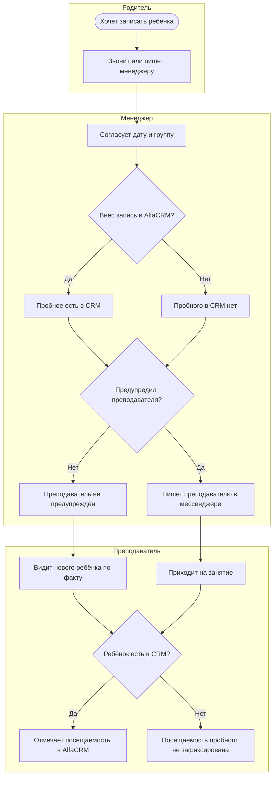

# Процессы

## AS-IS: запись на пробное занятие (как сейчас)

## Узкие места

| № | Место в процессе | Что не так |
|---|---|---|
| 1 | Шаг «Внёс запись в AlfaCRM?» | Внесение зависит от менеджера, обязательного правила нет |
| 2 | Шаг «Предупредил преподавателя?» | Оповещение неформальное, в личном мессенджере, не гарантировано |
| 3 | Шаг «Ребёнок есть в CRM?» | Если ребёнка нет в CRM, посещаемость не отмечается, статистика теряется |

## Вывод

Проблема возникает на стыке «менеджер → преподаватель»: данные создаёт один человек, а нужны они другому, и отдельного механизма передачи нет. Решение должно сделать внесение в CRM обязательным шагом и убрать зависимость от ручного оповещения.

## Допущения
- Общего чата или регламента для оповещения преподавателей нет.
- Менеджер пишет преподавателю лично, не в группу.
